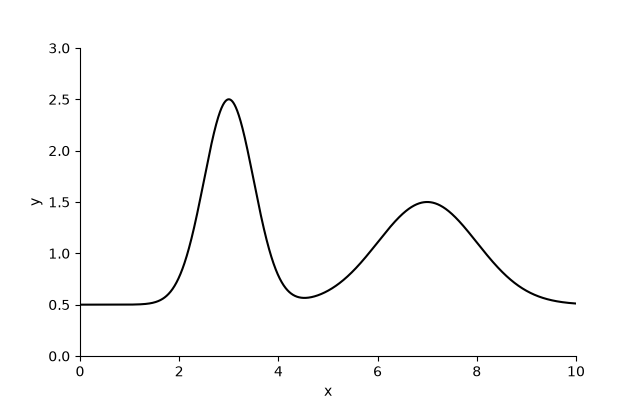
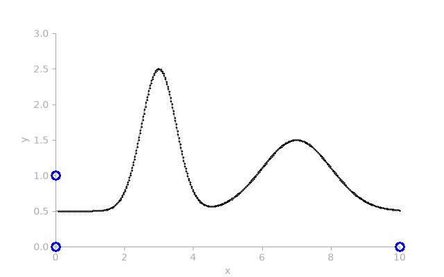
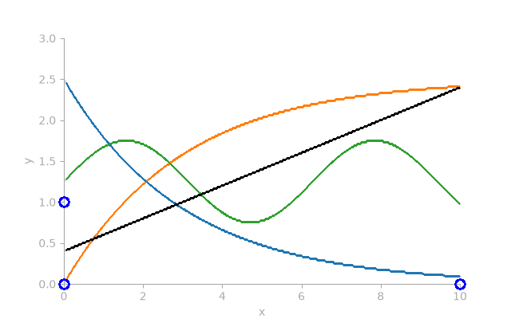
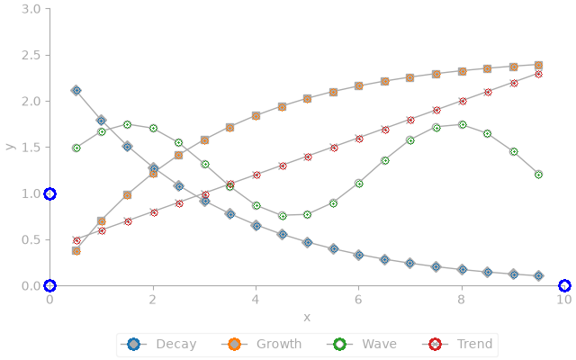
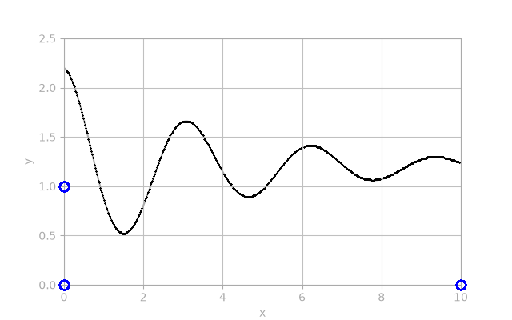
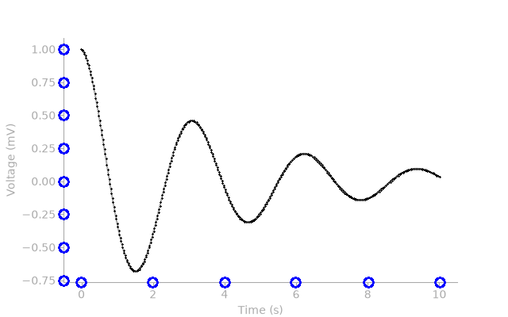
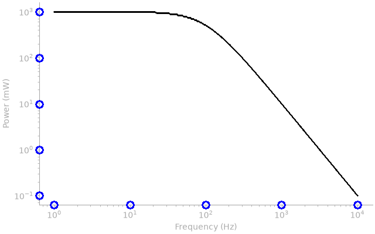
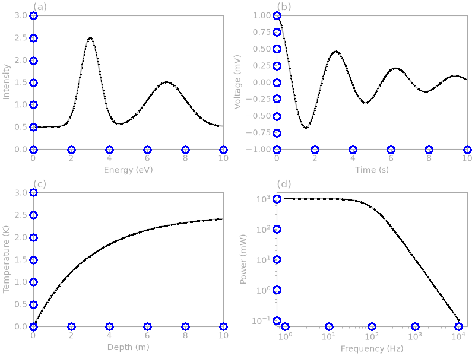
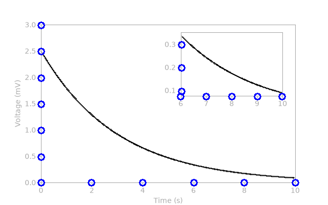
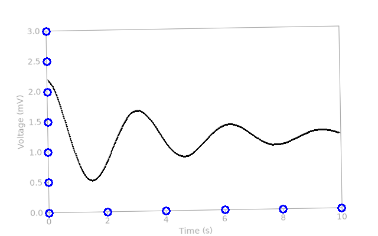

# figrecover

Recover data from images of plots. figrecover finds the curves in a picture of
a plot, such as a scanned figure or a screenshot, and writes their points as
CSV in the plot's own units. Curves are told apart by colour. It reads plots in
PDF and SVG files too, exactly, from what they draw rather than from pixels.

It suits batches of similar plots: calibrate once, then digitize every image
the same way from the command line.

## Installation

figrecover runs on Linux only, and needs Python 3.14 (a standard build;
OpenCV does not support the free-threaded build yet). Install the command
with [uv](https://docs.astral.sh/uv/):

```bash
uv tool install git+https://github.com/SMTG-Bham/figrecover
```

or with pip:

```bash
python -m pip install git+https://github.com/SMTG-Bham/figrecover
```

To have figrecover read the axes for you (see
[Reading the axes](#reading-the-axes)), install the `ocr` extra instead. It
adds the [RapidOCR](https://github.com/RapidAI/RapidOCR) text reader and its
models, so it needs no network access when it runs:

```bash
uv tool install "figrecover[ocr] @ git+https://github.com/SMTG-Bham/figrecover"
```

To read plots in PDF files (see [PDF files](#pdf-files)), install the `pdf`
extra, which adds the [pypdfium2](https://github.com/pypdfium2-team/pypdfium2)
PDF reader. Extras combine, as in `figrecover[ocr,pdf]`:

```bash
uv tool install "figrecover[pdf] @ git+https://github.com/SMTG-Bham/figrecover"
```

SVG files (see [SVG files](#svg-files)) need no extra: figrecover reads them
with Python's own XML parser.

## Usage

### 1. Prepare the image

Crop the image to the axes and the curves. figrecover ignores everything left
of the y-axis and below the x-axis, and inside a frame around the axes, as
matplotlib draws, everything beyond the frame too. It then traces the most
common colour that stands out from the background in what remains, skipping
filled areas and grid lines. Insets and legends inside a frame, as matplotlib
draws them, are painted out first, with all they hold; a legend without one
is traced too if it is the same colour as a curve, so crop or paint it out,
unless the series are told apart by their [markers](#markers). Dark
backgrounds work as well as light ones, and an image turned by a few
degrees, as scans often are, is levelled first; see
[Turned images](#turned-images). To have figrecover read the axes,
keep their tick labels and titles in the image. A figure of several plots,
such as panels labelled (a) and (b), or a plot with an inset, needs no
cropping when figrecover reads the axes; see [Several panels](#several-panels).

### 2. Choose reference points

figrecover maps pixels to data with at least three reference points: usually
the origin, a labelled tick on the x-axis and one on the y-axis. Give their
data coordinates with `-p` and their pixel positions with `-l`, in the same
order. Pixel positions are measured from the bottom-left corner of the image,
so the centre of the bottom-left pixel is at 0.5,0.5.
With the `ocr` extra, you can leave out both and let figrecover read the tick
labels instead; see [Reading the axes](#reading-the-axes). For logarithmic
axes, see [Logarithmic axes](#logarithmic-axes).

figrecover traces the part of the image above and right of the lowest and
leftmost reference points, so take them on the axis lines. If they lie a
little below or left of an axis line, up to 12 pixels, the part traced still
starts just beyond the line, as if they had been taken on it, though the
points are calibrated as given. A reversed axis,
whose values fall from left to right or from bottom to top, starts at its
largest value, so take the corner where the axes cross rather than the
origin, and ticks on the axis lines.

If you leave out `-l`, figrecover opens the image and asks you to click on each
reference point in turn (press q to cancel). It then prints the matching `-l`
options, ready to reuse for the rest of a batch of similar plots:

```text
figrecover: locations: -l 80.5,43.5 -l 576.5,43.5 -l 80.5,147.5
```

### 3. Digitize

```bash
figrecover examples/spectrum.png \
    -p 0,0 -p 10,0 -p 0,1 \
    -l 80,44 -l 576,44 -l 80,147 \
    -o spectrum.csv --preview spectrum.preview.png
```

The CSV file has a header and a row for each image column the curve crosses,
or more than one where it crosses a column more than once, as a loop does:

```text
x,y
0.0705645,0.495146
0.0907258,0.495146
...
```

Without `-o`, the CSV goes to standard output. The preview draws the recovered
curve in its own colour over a faded copy of the plot, and the reference points
in blue, so you can check the result at a glance:




| Option | Meaning |
| --- | --- |
| `-p`, `--point X,Y` | Data coordinates of a reference point. Repeat for at least three. Default: [read the axes](#reading-the-axes). |
| `-l`, `--location X,Y` | Pixel position of each reference point, in the same order. Default: click on them. |
| `--log AXES` | The axes of the `-p` reference points that are logarithmic: `x`, `y` or `xy`. Default: neither. |
| `-n`, `--series N` | Trace the N most common curve colours, and print the matching `-c` options. Default: 1. |
| `-c`, `--colour RRGGBB` | Hexadecimal colour of a curve to trace, such as `1f77b4`. Repeat for several curves. |
| `-m`, `--marker X,Y` | Pixel position of the marker in a series' legend key, or in a PDF file its position in points, to find the series by its markers' shape and colour. Repeat for each series. See [Markers](#markers). |
| `-o`, `--output FILE` | CSV file to write. Default: standard output. |
| `--preview IMAGE` | Also save a faded copy of the image with the recovered curves drawn on it. |
| `--remove-grid` | Paint over grid lines before tracing. |
| `--level DEGREES` | The angle by which the image's axes are turned anticlockwise, or clockwise if negative, to turn it back by. Default: find it; see [Turned images](#turned-images). |
| `--no-level` | Read the image as it is, without levelling it. |
| `--page N` | The page of a PDF file to read, from 1. Default: 1. |
| `--box X0,Y0,X1,Y1` | The part of a PDF file's page to read, such as one figure, as its left, bottom, right and top edges in points. Default: the whole page. |

### Several curves

Give the number of curves with `-n`:

```bash
figrecover examples/series.png \
    -p 0,0 -p 10,0 -p 0,1 -l 80,44 -l 576,44 -l 80,147 \
    -n 4 --preview series.preview.png
```

figrecover traces the four most common colours that stand out from the
background, the curve with the most pixels first, and prints their colours as
`-c` options:

```text
figrecover: colours: -c 2ca02c -c 1f77b4 -c ff7f0e -c 000000
```

The CSV gains a `series` column that numbers the curves in that order:

```text
series,x,y
1,0.0705645,1.2767
1,0.0907258,1.28641
...
```



Which curve has the most pixels can change from one plot to the next, so for
a batch, pass the printed `-c` options instead of `-n`. They fix the order of
the series, and each picks the curve whose colour is nearest, so they also
work on similar plots whose colours differ slightly, such as JPEG files. Give
only the `-c` options of the curves you want. The colours of plotting
libraries work too, such as `-c 1f77b4` for matplotlib's first colour.

Lines thinner than a pixel never show their full colour, as antialiasing
blends them with the background, nor do lines drawn translucent: a
`tab:blue` line at half opacity shows as `#8ebad9`. figrecover finds such
lines by the direction of their colour from the background, which their
blends share, and prints the strongest colour each shows, such as `eda2a3`
for a `tab:red` line a quarter of a point wide at 100 dots per inch. A `-c`
colour picks such a line too, as the line shows part of it: `-c d62728` picks
that line, and `-c 1f77b4` the translucent one.

`-n` skips colours that fill areas, those drawn mostly as straight lines
across the plot, such as grid lines, dashed or not and even with curves drawn
over them, those where two translucent colours overlap, such as two shaded
bands, and very pale ones, less than 64 levels from the background; trace a
pale curve with `-c` instead. Curves in neighbouring colours of a colour map,
such as viridis, are told apart, and two `-c` colours that match the same
curve are an error. When `-n` finds too few curves, it says which it found
and which colours it left out, and why, with how many pixels show each:

```text
figrecover: error: found only 1 of 3 curves, #000000 (1286 pixels); left out
#646464 (2041 pixels), as it is drawn in lines across the plot, as grid lines
are; #c8dcf0 (1732 pixels), as it is too pale, 54 levels from the background
```

Series that share a colour, as when a plotting library runs out of colours
and starts its cycle again, are traced as one. figrecover warns when a curve
crosses most columns more than once, as such curves do, or a loop:

```text
figrecover: the curve of colour #5c5c5c crosses most columns 2 times: it may be 2 curves of that colour, or loop
```

In a greyscale image, such as a photocopy, colours that differed may have
become one grey, and the edges of a dark curve, blended with the background,
show the lighter greys of other curves. figrecover leaves those edges out of
the lighter curves, and with several curves asked for, says that the image
is greyscale, as curves can then be told apart only by grey level; give
`-c` grey levels, such as `-c 808080`, or find series by their
[markers](#markers).

### Markers

When the series are told apart by their markers, as in many spreadsheet
charts, give the pixel position of the marker in each series' legend key with
`-m`, measured from the bottom-left corner like `-l`:

```bash
figrecover examples/markers.png \
    -p 0,0 -p 10,0 -p 0,1 -l 55,83 -l 627,83 -l 55,185 \
    -m 148,18 -m 260,18 -m 377,18 -m 483,18 --preview markers.preview.png
```

figrecover cuts each key's marker out of the legend, in its colour, leaving
out the line through it, and finds the markers of that shape and colour in
the plot. The CSV has a point at the middle of each marker, numbered by series
in the order of the `-m` options, and figrecover prints how many markers each
series has:

```text
figrecover: markers found in each series: 19, 19, 19, 19
```

The preview rings each marker, and each key, in a colour for its series:



- The markers can be filled or open, such as squares, diamonds, triangles,
  circles and crosses. Each series needs a shape or a colour of its own:
  series of one shape in several colours, as in `examples/coloured.png`,
  are told apart, and so are series that mix shapes and colours.
- Shapes that look alike at the image's size are told apart by fitting
  each to the marker to a fraction of a pixel. In `examples/similar.png`,
  whose circles, pentagons, hexagons and octagons are 6 points, or 8
  pixels, across, every marker is found in its series, and figrecover warns
  of the circles' keys, alike with the hexagons' and the octagons':

  ```text
  figrecover: the markers of the keys at 98,339 and 270,339 look alike at this size, so some may be taken for each other
  figrecover: the markers of the keys at 98,339 and 355,339 look alike at this size, so some may be taken for each other
  ```

  A marker that another key's marker fits almost as well is ambiguous, and
  figrecover prints how many each series has, and where, in the plot's x
  units, such as `series 1: 19 found, 2 of them ambiguous near x = 3.5, 7`.
- Lines and error bars that cross a marker are allowed for. A marker partly
  covered by another, as where series cross or crowd together, is found by
  what shows of it. Where the other series have markers at an x and a
  series has none, under another's marker, its marker is probably hidden
  there, and figrecover says so. In `examples/overlapping.png`, diamonds
  cover the tops of the circles below them, and the four series cross at
  x = 5:

  ```bash
  figrecover examples/overlapping.png -p 0,0 -p 10,0 -p 0,1 \
      -l 80,44 -l 576,44 -l 80,147 -m 98,339 -m 184,339 -m 270,339 -m 355,339
  ```

  ```text
  figrecover: markers found in each series: 16, 20, 17, 18
  figrecover: series 1: 16 found, 3 probably hidden near x = 4, 5, 5.5
  figrecover: series 3: 17 found, 2 probably hidden near x = 4.5, 5.5
  figrecover: series 4: 18 found, 1 probably hidden near x = 5
  ```

  The circle at x = 5 lies wholly under a square, and those at 4 and 5.5
  show half and a third of their ink between others. Markers mostly hidden
  can also be taken for another's: there, one square is a triangle, one
  triangle a diamond and one diamond a circle. Check the preview.
- A series without markers gets a warning, as its `-m` position or the axes
  may be wrong.
- Compressed images work too: `examples/markers.png` saved as a JPEG of
  quality 25 gives the same markers.
- The legend must be in the image, but may be in the plot area: its keys are
  not taken for markers. Nor are markers in an inset with a frame.
- In a PDF file, markers are read exactly, from what the PDF draws; see
  [PDF files](#pdf-files).

### Grids

Grids need no special handling, light or dark, because grid lines run
straight across the plot and curves do not:

```bash
figrecover examples/grid.png \
    -p 0,0 -p 10,0 -p 0,1 -l 80,44 -l 576,44 -l 80,167 \
    --preview grid.preview.png
```



A grid drawn in the same colour as a curve has to be removed first, with
`--remove-grid`.

### Reading the axes

With the `ocr` extra installed, leave out `-p` and `-l`, and figrecover reads
the tick labels and axis titles itself:

```bash
figrecover examples/labelled.png --preview labelled.preview.png
```

It prints what it read, so you can check it:

```text
figrecover: x-axis "Time (s)" with ticks at 0, 2, 4, 6, 8, 10
figrecover: y-axis "Voltage (mV)" with ticks at -0.75, -0.5, -0.25, 0, 0.25, 0.5, 0.75, 1
```

and names the CSV columns after the axis titles:

```text
Time (s),Voltage (mV)
0.00688239,0.999744
...
```

The preview circles each tick it read, on its axis line:



Each image is calibrated from its own labels, so the plots in a batch can have
different axes. The other options, such as `-n`, `-c` and `--remove-grid`,
work as before.

- The x-axis tick labels are the lowest row of three or more numbers, and the
  y-axis tick labels the leftmost column of three or more numbers above them,
  though the lowest may reach down beside them, as rotated labels can.
  Labels whose values are out of line with the rest, such as misread ones, are
  dropped. On a linear axis, labels must also take the even steps that
  plotting libraries label at: at low resolution OCR misreads digits as
  others, such as 750 as 758, close enough to their ticks to look in line,
  and those are dropped too. An axis with fewer than three labels in line
  cannot be read, so neither can a linear axis labelled at uneven values,
  such as 0, 273 and 373; give `-p` instead.
  Logarithmic axes are read too; see [Logarithmic axes](#logarithmic-axes).
  So are reversed axes, whose values fall from left to right or from bottom
  to top, as depth often does.
- Numbers can have thousands separators (`2,000` or `2 000`), a percent sign
  (`50%`, read in percent) or an exponent (`2.5e-3`). A tick mark that OCR
  reads as a dash beside a label, as it can where no axis line joins them, is
  ignored.
- Decimal commas work too, with points or spaces as thousands separators
  (`0,5` and `2.000`), as many European plots write them. A plot's labels
  decide: a label such as `0,5` reads as a number only with decimal commas,
  `0.5` only with decimal points, and `2.000` either way, so figrecover takes
  the way more labels read only one way, decimal points if neither wins. A
  single label misread with a comma does not outvote the rest.
- OCR can mistake letters for digits, and dashes for minus signs. In a label
  with a digit, O and o are read as 0, and l, I and | as 1 before a digit or
  a point, so `1O` and `l.5` read as 10 and 1.5; after a digit, they may be a
  unit, such as `5 l`, and are not read. Any dash before a number, such as
  an en or em dash, is a minus sign.
- A scale factor printed where plotting libraries put one, such as `1e-5` or
  `×10³` above the y-axis, or below the right half of the x-axis, multiplies
  that axis's tick values. Above the y-axis, it may lie beside the top half
  of the topmost tick label, as matplotlib prints it when that tick is at the
  top of the axis. Text elsewhere that looks like one, such as a legend entry,
  or the scale factor above the y-axis of a plot below, does not. An axis
  offset, such as `+1e3`, cannot be read.
- A power of ten in an axis title, after a bracket or a slash, as in
  `Current (×10⁻³ A)`, `Count (×10³)` or `Energy / 10³ J`, says the axis is in
  units of that power, so it multiplies the tick values too, and is left out
  of the column's name: `Current (A)`, `Count` or `Energy / J`. Units are not
  converted, so a column titled `Voltage (mV)` stays in millivolts.
- Each tick lies at the middle of its label, or at a tick mark: for labels
  that end at their tick marks rather than centring on them, as rotated
  x-axis labels do, at the mark at that end, and for labels that lie alike
  to one side of their marks, as matplotlib draws rotated y-axis labels, at
  the mark beside each.
  Labels written upwards on the x-axis, turned a quarter turn, are read as
  well as those written across. On the y-axis, labels written upwards or
  downwards are read too, though OCR runs them together, as in
  `1.25 1.50 1.75`, and misreads some, such as `2.5` as `25`: when most of
  them are taller than wide, figrecover reads them again with the image left
  of them turned a quarter turn each way, which takes about a second more,
  and takes the turn that OCR reads more surely, as it reads them less surely
  upside down. Labels of a single digit are read as they are. OCR often
  misreads x-axis labels at a slant, such as 45°, so if it misreads one and
  finds another's box tilted, figrecover reads the labels again with the
  image turned 45° each way, which takes about a second more, and takes their
  texts from the turn that reads the most of them as numbers. Labels at 60°
  can still be missed, and those misread, such as a 6 written downwards or
  at a slant on the y-axis, are dropped.
- figrecover traces the curves from the axis lines, not from the first ticks,
  so the margins that plotting libraries leave inside the axes are kept. If
  there are no axis lines, it starts just beyond the tick labels and their
  tick marks.
- A plot with a second y-axis on the right, with other values than the left
  one, cannot be read: crop the right axis out, or give `-p`.
- The titles are the nearest text below the x-axis tick labels and left of the
  y-axis ones, centred anywhere along their axes, so a title aligned with
  either end of its axis is read too. A title can run over several lines, as a
  `\n` breaks it, each within 1.25 line heights of the one before, by the
  taller of the two, and lined up with it, so a caption beside it, or further
  below, is left out; and the words of a line lie within a line height of
  each other, so text further along, such as the labels of other plots, is
  left out too. Tick labels broken over lines, such as `0\ns` with units
  under each number, are read by their first lines, and their other lines are
  not taken for the x-axis title. A y-axis title written upwards, as most are,
  is read again with the text left of the tick labels turned upright, which
  OCR reads more surely; one written across is read as it is. A column without
  a title is named `x` or `y`. Titles of a single letter are easily misread,
  such as `x` as `X`, or missed.
- Titles keep their Greek letters, symbols, superscripts and subscripts, such
  as `ΔE (%)`, `Wavelength (μm)` and `CO₂ (mg L⁻¹)`, and the CSV header
  writes them in UTF-8. OCR reads some symbols as either of two that look
  alike, so each is written one way: the increment sign as Greek Δ, the micro
  sign as Greek μ, and full-width signs, such as `％`, as plain ones. It can
  also read the raised minus sign of a superscript full size, so a minus sign
  before a superscript digit is raised, and `10−³` reads as 10⁻³, in titles
  and tick labels alike. OCR reads symbols less surely than letters, so
  check the printed titles. Turned upright, it has read `ΔE` as `ΔΔE`, so if
  a title reads upright as it first did but with a character twice,
  figrecover takes whichever reading OCR is surer of; `ΔΔG`, read alike both
  ways, is kept.

The titles of `examples/titled.png` run over two lines:

```bash
figrecover examples/titled.png
```

```text
figrecover: x-axis "Photon energy (eV)" with ticks at 0, 2, 4, 6, 8, 10
figrecover: y-axis "Absorbance (arb. units)" with ticks at 0, 0.5, 1, 1.5, 2, 2.5, 3
```

The x-axis tick labels of `examples/slanted.png` are written at 45°, which
OCR misreads as drawn, reading 2 as a Chinese character and 6 as 9, but reads
turned level:

```bash
figrecover examples/slanted.png
```

```text
figrecover: x-axis "Time (s)" with ticks at 0, 2, 4, 6, 8, 10
figrecover: y-axis "Voltage (mV)" with ticks at 0, 0.5, 1, 1.5, 2, 2.5
```

When a plot's labels cannot be read, give `-p` as before.

### Logarithmic axes

When figrecover reads the axes, it finds logarithmic ones itself: an axis is
logarithmic if more of its tick labels fall in line on a logarithmic scale
than on a linear one. It says so as it prints the ticks:

```bash
figrecover examples/logarithmic.png --preview logarithmic.preview.png
```

```text
figrecover: logarithmic x-axis "Frequency (Hz)" with ticks at 1, 10, 100, 1000, 10000
figrecover: logarithmic y-axis "Power (mW)" with ticks at 0.1, 1, 10, 100, 1000
```



The tick labels can be decimals, such as `0.01` and `1000`, or powers with
superscript exponents, such as 10⁻², 2×10³ and 2⁵, as matplotlib draws them.
OCR often misses a superscript, reading 10² as `102` and 2⁵ as `25`, so
figrecover checks how a label of digits is drawn: if its last digit sits
raised above the others, the raised digits are an exponent and the full-size
ones its base, and a raised minus sign before the exponent makes it negative.
Each axis takes the base that most of its powers have. A label that reads as
that base followed by digits, but is not drawn that way, is still a power if
most of the others on its axis are, so an axis whose labels all read as
`100`, `101`, `102` is logarithmic when they are drawn as 10⁰, 10¹, 10²,
while labels really drawn as 100, 101, 102 stay linear, even if one is
misread as a power. As on a linear axis, three labelled ticks are needed, so
an axis labelled only at 10⁰ and 10¹ cannot be read.

The plot in `examples/binary.png` is labelled with powers of two, most of
whose superscripts OCR misses:

```bash
figrecover examples/binary.png
```

```text
figrecover: logarithmic x-axis "Size (KiB)" with ticks at 1, 2, 4, 8, 16
figrecover: logarithmic y-axis "Time (ms)" with ticks at 0.25, 0.5, 1, 2, 4, 8, 16, 32, 64
```

Superscripts are small, so at low resolution OCR can misread them as other
digits, such as 2¹⁶ as `226`, and an axis whose exponents are all misread
alike is read wrongly. Check the printed ticks.

With `-p`, name the logarithmic axes with `--log x`, `--log y` or `--log xy`.
Reference points on a logarithmic axis must be positive, so take the lowest
labelled tick as the origin, rather than zero:

```bash
figrecover examples/logarithmic.png \
    -p 1,0.1 -p 1e4,0.1 -p 1,1e3 -l 93,66 -l 610,66 -l 93,380 --log xy
```

### Several panels

A figure of several plots, such as panels labelled (a), (b), (c), is read
panel by panel when figrecover reads the axes:

```bash
figrecover examples/panels.png -o panels.csv --preview panels.preview.png
```

It prints what it read of each panel, named after its label, and the files
it wrote:

```text
figrecover: panel a: x-axis "Energy (eV)" with ticks at 0, 2, 4, 6, 8, 10
figrecover: panel a: y-axis "Intensity" with ticks at 0, 0.5, 1, 1.5, 2, 2.5, 3
figrecover: panel b: x-axis "Time (s)" with ticks at 0, 2, 4, 6, 8, 10
figrecover: panel b: y-axis "Voltage (mV)" with ticks at -1, -0.75, -0.5, -0.25, 0, 0.25, 0.5, 0.75, 1
figrecover: panel c: x-axis "Depth (m)" with ticks at 0, 2, 4, 6, 8, 10
figrecover: panel c: y-axis "Temperature (K)" with ticks at 0, 0.5, 1, 1.5, 2, 2.5, 3
figrecover: panel d: logarithmic x-axis "Frequency (Hz)" with ticks at 1, 10, 100, 1000, 10000
figrecover: panel d: logarithmic y-axis "Power (mW)" with ticks at 0.1, 1, 10, 100, 1000
figrecover: wrote panels_a.csv, panels_b.csv, panels_c.csv, panels_d.csv
```

Each panel's CSV is like a single plot's, with its columns named after the
panel's own axis titles. Without `-o`, standard output gets one CSV with a
`panel` column first, whose other columns are named after the axis titles if
every panel has the same ones, or `x` and `y`:

```text
panel,x,y
a,0.117437,0.505713
...
```

The preview draws every panel's curves and ticks on the one image:



The panels of `examples/shared.png` share their axes, so matplotlib labels
the x-axes only on the lower panels, and the y-axes only on the left ones.
Each panel takes the axes that it lacks from those beside it:

```bash
figrecover examples/shared.png -o shared.csv
```

```text
figrecover: panel a: x-axis "Time (s)" with ticks at 0, 2, 4, 6, 8, 10
figrecover: panel a: y-axis "Voltage (mV)" with ticks at 0, 0.5, 1, 1.5, 2, 2.5, 3
figrecover: panel b: x-axis "Time (s)" with ticks at 0, 2, 4, 6, 8, 10
figrecover: panel b: y-axis "Voltage (mV)" with ticks at 0, 0.5, 1, 1.5, 2, 2.5, 3
...
figrecover: wrote shared_a.csv, shared_b.csv, shared_c.csv, shared_d.csv
```

An inset, a smaller plot drawn in a frame inside a plot's axes, as
matplotlib's `inset_axes` draws one, is read as a panel of its own, with its
own axes, while the plot's curves are traced with it painted out:

```bash
figrecover examples/inset.png -o decay.csv --preview inset.preview.png
```

```text
figrecover: x-axis "Time (s)" with ticks at 0, 2, 4, 6, 8, 10
figrecover: y-axis "Voltage (mV)" with ticks at 0, 0.5, 1, 1.5, 2, 2.5, 3
figrecover: panel inset: x-axis with ticks at 6, 7, 8, 9, 10
figrecover: panel inset: y-axis with ticks at 0.1, 0.2, 0.3
figrecover: wrote decay.csv, decay_inset.csv
```

The plot keeps the name it has without the inset: none, in an image of one
plot, so its curves go to `decay.csv`, as they would without the inset, and
the inset's, in its own units, to `decay_inset.csv`. Without `-o`, standard
output gets one CSV with a `panel` column, empty for the plot and `inset`
for its inset. An inset is named after the panel it lies in, such as
`b_inset` in panel (b), and several insets in one panel are numbered in
reading order, such as `inset1` and `inset2`.



- The panels are found by their axes: a horizontal and a vertical axis line,
  each at least a tenth of the image's shorter side long, that meet, as
  matplotlib's frames do too. An image with one such plot, or none, such as
  plots without axis lines, is read as one plot, as before. Axes inside
  another's are found as insets instead.
- An inset is a frame inside a panel's plot area, one of those painted out
  before the panel's curves are traced (see [How it works](#how-it-works)),
  whose axes can be read. They are read from its part of the plot area,
  which holds its tick labels and titles and runs up to just short of the
  other frames there, as a panel's part runs up to the panels around it.
  The text in it is that already read in the panel, so an inset takes
  little longer to read. Its curves are traced inside its frame. A frame
  whose axes cannot be read, such as a legend's, or an inset's without tick
  labels, stays painted out, without a warning.
- Each panel is read from its part of the image, which holds its tick labels
  and titles, and runs up to just short of the axes of the panels around it.
  On the right, it stops at the tick labels or title of the panel beside it,
  so they are not read as a second y-axis.
- Panels are named in reading order, in rows from the top, each from the
  left. A panel's label is the text nearest the top-left corner of its axes,
  inside or outside them, within a quarter of their width and height, written
  as a letter: (a), a), a. or a. OCR misreads single letters in brackets,
  such as (b) and (d) as (p), and misses some, but panels are labelled in
  reading order, so if more than half the labels read are a, b, c… in that
  order, counting a p read for b or d, every panel takes its letter in that
  order, as capitals if most of those read are. Otherwise each panel keeps
  the letter read, and one without, or with a letter read for another panel
  too, is named by its number in reading order. The labels of other panels
  are not read as a panel's titles, such as the label of the panel below, if
  it lies above that panel's axes.
- A panel's label is painted over, inside its axes, before its curves are
  traced, as it is usually drawn in a curve's colour. A label that OCR does
  not find at all is traced as part of a curve of its colour, as a legend
  without a frame is.
- Plots that share an axis often label its ticks only on the outer panels:
  an x-axis on the lowest panel of a column, and a y-axis on the leftmost of
  a row. A panel without tick labels on an axis takes that axis, and its
  title, from the nearest panel read that lines up with it along the axis:
  in the same column for the x-axis, or the same row for the y-axis, with
  the ends of its axes within 5% of their length of the panel's. Its ticks
  lie where that panel's do, in the whole image. So a panel can take its
  x-axis from the panel below it and its y-axis from the panel beside it.
- A panel whose axes cannot be read, such as a colour bar with a frame, or a
  panel without tick labels on an axis that no panel read lines up with, is
  left out with a warning, as is one whose curves cannot be traced.
  figrecover fails only if no panel is left.
- `-n` and `-c` apply to each panel, and `-n` prints the colours of each.
  `-m` needs an image of one plot, and leaves its insets painted out, unread.
  With `-p`, the image is one plot, and its insets are painted out, as
  before.
- Each panel takes about as long to read as a plot, about two seconds.

### Turned images

A scanned or photocopied plot is seldom quite level, and a turn of a quarter
of a degree, two pixels across a plot, is enough for its axis lines or frame
to be traced as part of a curve. So figrecover finds the angle by which an
image's axes are turned, and turns the image back before reading it:

```bash
figrecover examples/skewed.png --preview skewed.preview.png
```

```text
figrecover: turned the image 1.00° clockwise to level its axes
figrecover: x-axis "Time (s)" with ticks at 0, 2, 4, 6, 8, 10
figrecover: y-axis "Voltage (mV)" with ticks at 0, 0.5, 1, 1.5, 2, 2.5, 3
```

The preview is drawn on the image as given, with the curves and the ticks
turned back onto it:



- The angle is that of the image's long straight lines, within 10° of
  horizontal or vertical, such as the axis lines, a frame and grid lines,
  each measured to a fraction of a pixel along its length. The straight
  stretches of curves are lines too, so it is the angle that most of the
  lines' length agrees on, and only if horizontal and vertical lines agree
  on it, as the axis lines do. On plots turned by 0.25° to 5°, it is found
  within 0.01°.
- An image turned less than 0.1° is read as it is, as it reads as well as
  it would levelled, so the results for level images are as they were. So
  is an image without both a horizontal and a vertical line that agree,
  such as a plot without axis lines; give `--level` for it.
- The image is turned about its middle, onto an image large enough to hold
  all of it, its corners filled in its background colour, and moved by up
  to half a pixel so that the axis lines run along rows and columns of
  pixels, as they were drawn, rather than blurred across two.
- `-l` and `-m` positions are those in the image as given, as are those
  printed when you click, and are turned with it.
- On a framed plot and one with only a left and a bottom axis line, turned
  by 0.25° to 5° either way, no axis line or frame is traced, and the curves
  are as close as in the plots drawn level: within 0.002 of the y-axis's
  span by the median, both from `-p` and `-l` and with the axes read, and
  0.009 at most.
- `--level DEGREES` sets the angle by hand: the angle by which the axes are
  turned anticlockwise, or clockwise if negative. `--no-level` reads the
  image as it is, for a plot drawn turned on purpose.
- Finding the angle takes about 0.02 s for an image of 640 × 400 pixels,
  and 0.1 s for one of 1920 × 1200, as a plot scanned at 300 dpi is; turning
  the image takes about half as long again.

### PDF files

With the `pdf` extra installed, give a PDF file instead of an image, and
figrecover reads the plot on its first page exactly, from what the PDF draws
rather than from pixels. The tick labels and titles are text, so they need no
OCR, and the curves are lines through points whose positions the PDF holds:

```bash
figrecover examples/labelled.pdf --preview labelled.pdf.png
```

```text
figrecover: x-axis "Time (s)" with ticks at 0, 2, 4, 6, 8, 10
figrecover: y-axis "Voltage (mV)" with ticks at -0.75, -0.5, -0.25, 0, 0.25, 0.5, 0.75, 1
```

```text
Time (s),Voltage (mV)
-1.11905e-07,1
0.0250124,0.992523
...
```

On the example PDFs, which matplotlib draws, the recovered points lie within
4×10⁻⁷ of the true curves, in the units of the axes, or in decades on
logarithmic ones: the PDF reader holds positions to about seven significant
figures, and the CSV file writes six. Each curve gives the points that it is
drawn through, in the order they are drawn, rather than a point per column of
pixels. Plotting libraries leave out points that lie on a straight line
between their neighbours, as matplotlib does, so a straight line gives only
its ends.

- Positions on a PDF's page are in points, 72 to the inch, from its bottom-left
  corner, as PDF files give them. So are `-l` locations, and those that
  figrecover prints when you click. The preview shows the part of the page
  read, at 2 pixels to the point.
- `--page N` reads another page than the first. On a page with several
  figures, such as a page of a paper, give the part of it to read with
  `--box X0,Y0,X1,Y1`: its left, bottom, right and top edges in points. Text
  outside the box, and lines beyond it, are left out. Figures that a document
  takes in from other PDF files, as LaTeX does, are read too.
- The axes are read as they are from an image (see
  [Reading the axes](#reading-the-axes)), but from the PDF's text, whose
  superscripts and subscripts show by the sizes and heights of their
  characters. The axis lines are the straight lines nearest the tick labels,
  and each tick lies exactly at its tick mark, or its grid line: the mark
  nearest the middle of its label, or, for rotated labels, the end.
- Curves are told apart by the colour they are drawn in, and `-n` and `-c`
  work as they do for images; `-n` ranks curves by their length. Lines
  straight along an axis, such as axis lines, tick marks, grid lines and the
  lines in a legend's keys, are left out, as are closed shapes, such as
  frames, filled areas, and points hidden beyond the limits of the axes.
- Markers, as in scatter plots and lines with markers, give the points they
  mark, exactly: matplotlib places each marker on the page at its point. A
  colour drawn with markers gives their points, in the order they are drawn,
  rather than the line through them, and `-n` and `-c` tell such series apart
  by colour too: a marker's colour is its fill, or its outline's for open
  markers. Series that share a colour, as in `examples/markers.pdf`, are told
  apart by their markers' shapes with `-m`, given the position in points of
  each series' marker in the legend, or of any of its markers. The markers
  in a legend, with their labels beside them, and the caps of error bars are
  left out. On `examples/markers.pdf` and `examples/scatter.pdf`, every
  marker is found, even where series cross, within 3×10⁻⁶ of its point.

```bash
figrecover examples/markers.pdf \
    -m 108.45,12.91 -m 187.85,12.91 -m 272.06,12.91 -m 347.51,12.91
```

```text
figrecover: x-axis "x" with ticks at 0, 2, 4, 6, 8, 10
figrecover: y-axis "y" with ticks at 0, 0.5, 1, 1.5, 2, 2.5, 3
figrecover: markers found in each series: 19, 19, 19, 19
```

- Curves drawn as images, as plots of many points often are to keep their PDF
  files small, are traced as they are in an image, from the image's own
  pixels, and placed where the image lies on the page, while the axes are
  still read from the PDF's text and lines. On `examples/rasterised.pdf`,
  whose curves matplotlib draws as an image at 100 dots per inch, they are
  within 0.006 of the true curves, about half a pixel. `--remove-grid` paints
  over grid lines in such images.

```bash
figrecover examples/rasterised.pdf -n 2
```

```text
figrecover: colours: -c ff7f0e -c 1f77b4
```

### SVG files

Give an SVG file, and figrecover reads it as it reads a PDF file, exactly,
from what it draws: its text, its paths, through their transforms and clip
paths, and its images. It needs no extra. Files compressed with gzip, such as
`.svgz` and `.svg.gz` files, are read too, and a file named otherwise is taken
for an SVG file if it starts with a tag, and an `<svg` tag in its first 4 KiB:

```bash
figrecover examples/labelled.svg
```

```text
figrecover: x-axis "Time (s)" with ticks at 0, 2, 4, 6, 8, 10
figrecover: y-axis "Voltage (mV)" with ticks at -0.75, -0.5, -0.25, 0, 0.25, 0.5, 0.75, 1
```

The examples `labelled`, `logarithmic`, `series`, `markers` and `rasterised`
are saved as SVG files twice: `name.svg` with its text drawn as glyph outlines,
as matplotlib draws it by default, and `name-text.svg` with
`svg.fonttype: none`, as text. On both, the recovered points lie within
4×10⁻⁸ of the true curves, as matplotlib writes positions to six decimal places
of a point, every marker within 2×10⁻⁸ of its point, and the curves drawn as an
image in `rasterised.svg` as closely as in `rasterised.pdf`.

- Positions in an SVG file are in points from the bottom-left corner of its
  drawing, as in a PDF file: so are `-l` locations and `--box`, which chooses
  part of the drawing to read; `--page` is refused. A user unit, in which an
  SVG file places what it draws, is a CSS pixel, 0.75 points, unless the
  root's `width`, `height` and `viewBox` make it otherwise: matplotlib's are
  points, so its SVG and PDF files share their positions.
- Text is read from `<text>` and `<tspan>` elements, each character placed by
  its `x`, `y`, `dx` and `dy`, through `transform`s, so rotated titles read as
  in a PDF file. Superscripts and subscripts are found by their sizes and
  heights, raised or lowered by `baseline-shift`, or by `dy` as Plotly raises
  its exponents. An SVG file does not give the widths of its characters, so
  each is taken to be 0.6 of its font size wide, 0.7 for capitals, or 0.3 or
  0.9 for narrow and wide ones: a label anchored at its middle or end, as
  tick labels usually are, lies exactly where it is drawn, and its tick at
  its tick mark.
- matplotlib's text drawn as glyph outlines is read from the comment that
  matplotlib writes before each line of it, in a group whose id starts
  `text_`, with mathtext such as `$\mathdefault{10^{-1}}$` written as plain
  text, `10⁻¹`, and the box of the outlines. So is its mathtext written as
  text, which matplotlib writes a character at a time, grouped by font rather
  than in the order they are read.
- Markers drawn with `<use>`, as matplotlib draws them, mark the point at the
  `x` and `y` of the `<use>`, as a form marks its origin in a PDF file; other
  markers, such as `<circle>` elements or Plotly's paths of arcs, mark the
  middles of their boxes. Arcs pass through their points at each quarter turn
  of their ellipses, as do circles and ellipses.
- Colours come from presentation attributes, such as `stroke="#1f77b4"`, and
  `style` attributes, as elements inherit them, in hexadecimal, `rgb()` or by
  name, including `currentColor`; `opacity` and `stroke-opacity` of 0 hide a
  path. Each path keeps its stroke width and dash pattern, and a gradient
  paints in its first colour.
- Images, given as data URIs or as files beside the SVG file, are traced as in
  a PDF file, placed and turned as they are shown: matplotlib draws them
  upside down and turns them over.
- The preview is drawn by figrecover itself, with OpenCV: the paths, the
  images and the text, in a font of its own.
- Files that declare XML entities are refused, as their entities can expand
  to fill the memory: the "billion laughs" is refused in a tenth of a
  millisecond. So are files of more than 64 MiB, decompressed, and those
  that draw more than a million elements, counting each `<use>`.

### Python

The same steps are available as a library:

```python
from figrecover import Calibration, load_image, trace_curve

image = load_image("examples/spectrum.png")
calibration = Calibration.from_points(
    data=[(0, 0), (10, 0), (0, 1)],
    pixels=[(80, 44), (576, 44), (80, 147)],
)
data = calibration.to_data(trace_curve(image, calibration.origin))
```

or, with the `ocr` extra, reading the axes:

```python
from figrecover import load_image, read_axes, trace_curve

image = load_image("examples/labelled.png")
axes = read_axes(image)
data = axes.calibration.to_data(trace_curve(image, axes.calibration.origin))
print(axes.x_title, axes.y_title)  # Time (s) Voltage (mV)
```

For logarithmic axes, pass `x_log=True` or `y_log=True` to
`Calibration.from_points`; `read_axes` sets them itself.

`read_panels` reads each panel of a figure, in reading order. A `Panel` has
its `label`, such as `"a"`, or None; its `image`, the panel's part of the
image, in which to trace its curves, with its label painted over; its `axes`,
in pixels of its image; the `offset` of its image's bottom-left corner in
the whole image; and `inset_of`, the panel that an inset lies in, or None.
An image of one plot is one panel, of the whole image, and each inset
follows the panel it lies in, without a label:

```python
from figrecover import load_image, read_panels, trace_curve

for panel in read_panels(load_image("examples/panels.png")):
    calibration = panel.axes.calibration
    data = calibration.to_data(trace_curve(panel.image, calibration.origin))
    print(panel.label, panel.axes.x_title)  # a Energy (eV), b Time (s), ...
```

For several curves, `find_colours` returns the colours of the most common
curves as `(red, green, blue)` tuples, and `trace_curves` traces one curve per
colour. Pixel positions are those of pixel centres, and a curve that crosses a
column more than once gives a point for each crossing, sorted by x, then y:

```python
from figrecover import find_colours, trace_curves

colours = find_colours(image, 4, calibration.origin)
curves = trace_curves(image, colours, calibration.origin)
data = [calibration.to_data(curve) for curve in curves]
```

For series told apart by their markers, `find_markers` takes the pixel
position of each series' legend key, and returns the middle of each marker of
that shape:

```python
from figrecover import Calibration, find_markers, load_image

image = load_image("examples/markers.png")
calibration = Calibration.from_points(
    data=[(0, 0), (10, 0), (0, 1)],
    pixels=[(55, 83), (627, 83), (55, 185)],
)
keys = [(148, 18), (260, 18), (377, 18), (483, 18)]
markers = find_markers(image, keys, calibration.origin)
data = [calibration.to_data(series) for series in markers]
```

`find_marker_series` takes the same arguments and gives more: for each
series, a `MarkerSeries` with its markers' `points`, whether each is
`ambiguous`, and where its markers are probably `hidden`, in pixels. Keys
whose markers look alike at the image's size give a `UserWarning`.

`load_image` returns an RGB array, and `remove_grid(image)` paints over grid
lines first, if needed.

`level_image` levels an image whose axes are turned, as the command does. It
returns the levelled image, and a `Levelling`, whose `angle` is the angle the
image was turned back by, or 0 if it was left as it is, and whose `points`
and `back` methods find where pixel positions lie in the levelled image, and
back:

```python
from figrecover import Calibration, level_image, load_image, trace_curve

image, levelling = level_image(load_image("examples/skewed.png"))
pixels = levelling.points([(82.8, 39.8), (578.7, 48.5), (81.0, 142.5)])
calibration = Calibration.from_points([(0, 0), (10, 0), (0, 1)], pixels)
data = calibration.to_data(trace_curve(image, calibration.origin))
```

`level_image(image, angle)` turns the image back by a given angle, and
`find_skew(image)` returns the angle alone.

With the `pdf` extra, `load_pdf` reads what a page of a PDF file draws, and
the same steps work on it, in points from the page's bottom-left corner; so
does `load_svg`, for an SVG file, without the extra:

```python
from figrecover import find_pdf_colours, load_pdf, read_pdf_axes, trace_pdf_curves

drawing = load_pdf("examples/series.pdf", page=1)
axes = read_pdf_axes(drawing)
origin = axes.calibration.origin
curves = trace_pdf_curves(drawing, find_pdf_colours(drawing, 4, origin), origin)
data = [axes.calibration.to_data(curve) for curve in curves]
```

`load_pdf` takes the part of the page to read as `box`, a tuple of its left,
bottom, right and top edges in points. `render_pdf(drawing)` draws that part
as an image, at 2 pixels to the point, and `remove_pdf_grid(drawing)` paints
over grid lines in the images that it draws. `find_pdf_markers(drawing, keys,
origin)` finds series by the shapes of their markers, as `find_markers` does
in an image, from the position of a marker of each series in points.
`load_svg(path, box)` takes the part of an SVG file's drawing to read in the
same way, and `render_svg(drawing)` draws what it read, with OpenCV.

## How it works

1. The image is read in colour and stretched to the full 0–255 range.
   Transparent pixels become white. If its axes are turned, it is levelled:
   lines at least a fifth of the image's shorter side long, within 10° of
   horizontal or vertical and at most 8 pixels thick, are found in its ink
   with a probabilistic Hough transform. In each column across a line close
   to horizontal, or each row across one close to vertical, the line's middle
   is the mean position of the ink within 4 pixels of it, weighted by its
   darkness, and the line's angle that of the straight line through its
   middles by least squares, leaving out those where other ink meets it. The
   angle that most of the lines' length agrees on, within 0.05°, is the
   image's, if both horizontal and vertical lines agree on it, and if it is
   0.1° or more, the image is turned back by it with Lanczos interpolation.
2. A least-squares fit through the reference points gives a linear map from
   pixels to data for each axis, or to the logarithm of the data for a
   logarithmic axis. The leftmost and lowest reference points mark the axes.
3. Pixels left of and below the axes are ignored, which drops the axes, their
   ticks and labels. So are axis lines up to 12 pixels inside the axes
   given: rows or columns of ink near them that run unbroken from the other
   axis across 60% of the plot. A frame closing the axes, a thin line along
   the top half from the y-axis that meets one down the right, is dropped
   with everything beyond it. Frames inside what remains, such as those of insets and
   legends, are painted in the background colour with all they hold, and 3
   pixels around them, so an inset's curve or a legend's key is not traced
   as part of a curve of its colour. A frame is a box of four straight lines
   of one colour, each at least 5% of the plot's shorter side long, at most
   8 pixels thick, and 32 levels or more from the background, so light grey
   legend frames count too. The lines along its top and bottom run from one
   side to the other, and a line down each side runs along three quarters
   of its height or more, so its corners are square or rounded by a few
   pixels. Lines may run on past its corners, as an inset's tick marks and
   the lines to the part it magnifies do, but the top and bottom must each
   end at a side, which grid lines do not. A step plot's flat and upright
   stretches never close a box, and filled areas, such as bars and shaded
   spans, are thicker than lines. A frame hides what lies behind it, so a
   box that a curve crosses, with ink of like colours, less than 48 levels
   apart, within 3 pixels of a line on both sides, is not one, such as a
   box drawn around part of a curve or marking the part an inset magnifies.
   An inset's tick marks, in the colour of its frame, do not cross it where
   its curve meets the frame inside, nor do its grid lines.
4. A coarse colour histogram gives the common colours: those with enough pixels
   to span the plot, merging shades less than 48 levels apart. Each is then
   counted again in a finer histogram, and split if it holds two or more
   colours with enough pixels, such as neighbouring colours of a colour map.
   The most common is the background, unless the colour along the top of the
   plot differs from it by 64 levels and has at least a third as many pixels:
   then the most common colour is a filled area. Antialiasing blends the edges
   of each curve with the background, and a blend can be common too, so a
   colour whose pixels mostly touch those of a colour further from the
   background is dropped. So is a colour whose pixels show several inks along
   separate lines, as the pale blends of thin lines of several colours do
   when counted as one: a pixel's ink is its direction from the background,
   which antialiasing and transparency leave as it is, and directions less
   than 6 degrees apart are one ink's.
5. A thin line never reaches its full colour, and its shades are each too
   rare to count. So the pixels that show some ink, 16 levels or more from
   the background, that no common colour claims, other than the pale edges
   of its own pixels, are taken by their inks, and an ink whose pixels,
   weighted by their strength, add up to half a pixel for each column of the
   plot at full strength is a colour too. Each colour is then the strongest
   its pixels show along its direction, but for a fiftieth of them, so an
   opaque line gives its own colour, and a thinner one its strongest shade.
6. The curves are the colours that differ from the background by at least
   64 levels in some channel, most pixels first, except those whose pixels
   lie mostly more than 4 pixels inside their shapes, which fill areas; those
   drawn mostly as straight lines across 60% of the plot, as grid lines are;
   and those that blend two other colours, a tenth of each or more, half of
   whose surrounding pixels show those two, as where translucent bands
   overlap. `-c` instead picks the colour nearest to each given colour, up to
   96 levels away, or failing that the nearest whose direction lies within
   12 degrees of its own, no further from the background: a thin or
   translucent line of that colour.
7. Each pixel belongs to the colour that it best matches when blended
   with the background, if it is at least half-way there, so a curve's
   antialiased edges count towards it, and within 96 levels of the blend, so
   ink of other colours, such as the black text and arrows of annotations
   among coloured curves, is not taken for the nearest curve. A pixel of a
   colour that touches those of a stronger colour of the same ink, within 12
   degrees, is that colour's edge, such as the pale grey edge of a black
   curve, and belongs to neither. Specks of fewer than four pixels, such as
   where two other curves cross, are ignored.
8. In each image column, a curve's pixels form runs, split by gaps of more
   than 6 pixels, and runs that overlap one to one in neighbouring columns
   form branches. Each run of a branch across at least 5% of the plot gives a
   point at its median height, so both sides of a loop are traced, and shorter
   pieces beside a longer branch, such as the caps of error bars, are ignored.
   A column without such a run gives one point at the median height of all
   its pixels.

With `-m`, steps 4 to 8 give way to these:

1. Each key's colour is the direction, seen from the background, of the
   strongest ink of the piece nearest the key's position, and keys whose
   colours lie 10 degrees apart or less share one. Each pixel shows the key
   colour whose direction lies nearest its own, if 20 degrees away or less,
   and none of the others, so series of one shape are told apart by colour,
   and ink of other colours is left out.
2. Each key's marker is the piece of ink in its colour, 64 levels or more
   from the background, nearest the key's position, leaving out specks of
   fewer than four pixels. A key at least 1.5 times as wide as tall may have
   a line through its marker: the rows with ink within 3 pixels of its ends.
   It does if they are fewer than the marker's rows, the other rows with ink
   at least half as strong as the strongest, as compression leaves fainter
   ink beside the line. The line is masked out of the marker, as lines cross
   the markers in the plot at other angles, except where the marker hides
   it, differing from the line's level by more than a quarter of the range,
   as an open marker's face does. Keys of one colour whose markers, fitted
   to each other as in step 4, differ by less than 5% look alike, and give a
   warning.
3. A marker lies where a key's marker correlates with the plot by 0.6 or
   more, and the plot has at least 60% of the ink of each half of the
   marker, top, bottom, left and right, so a thin marker, such as a cross,
   is not found along a line. Matches are taken best first, leaving out those
   less than three quarters of a marker's width from a marker already found.
4. Where other keys' markers score within 0.05 of a match, up to 2 pixels
   away, each is fitted to the plot, shifted by the match's fraction of a
   pixel, where it differs least by the normalised sum of squared
   differences, which, unlike a correlation, tells circles from octagons.
   With it, up to two markers that it partly hides, or that partly hide it,
   are found, as in step 5, and it is moved to fit what they leave
   uncovered. The marker that, with those, differs least from the plot
   wins, and is ambiguous if another differs less than 30% more.
5. Markers partly hidden under those found, or over them, are then looked
   for around each, in what all those found leave uncovered: what shows
   must hold a fifth or more of the key's ink, correlate with the key's
   marker by 0.75 or more, and explain the plot under it at least 60%
   better than the markers found alone.
6. Series usually share x positions. Where two of a series' markers lie
   further apart than one and a half times their usual spacing, and other
   series have markers at an x between them, the series' marker would lie
   there, on the straight line between its two. If another series' marker
   lies over that place, the marker is looked for again there, as in step
   4, and is otherwise reported as probably hidden.
7. Each marker's middle is placed to a fraction of a pixel.

On the examples, the recovered values are within 0.03 of the true curves, about
three pixels at the steepest point, and the markers within 0.02 of the points
they mark, about two pixels.

With a PDF file, steps 1 to 8 give way to these:

1. [PDFium](https://pdfium.googlesource.com/pdfium/), through pypdfium2, reads
   the characters, paths and images that the page draws, each with the matrix
   that places it on the page, through any forms that hold it. Characters
   along a line less than 0.6 of their font size apart make a text, with a
   space where they lie 0.2 of it apart or more. Characters at most 0.85 the
   size of their line's largest, and 0.15 of its size or more above or below
   it, are superscripts or subscripts.
2. The tick labels and titles are read from the texts as they are from those
   that OCR reads. The x-axis line is the lowest straight horizontal line
   above the x-axis tick labels that runs along 90% of their span, and the
   y-axis line likewise the leftmost vertical one right of the y-axis's.
3. The tick marks are the straight lines across an axis line that reach to
   within a tenth of a label's height of it. Labels whose middles lie within
   half a label's height of the marks are centred on their ticks; others are
   aligned by the ends nearest the marks, as rotated labels are. Each tick
   lies at the mark nearest its label's middle or end, within a quarter of the
   tick spacing.
4. The curves are the paths that are stroked but not filled, by colour,
   without their subpaths that are closed or that lie along a straight
   horizontal or vertical line. Points left of or below the axes, or outside
   the path's clip, are left out. Curved pieces give their ends, not their
   control points. Curves are ranked by the length of the lines through their
   points.
5. Markers are shapes at most 36 points across, other than a straight
   horizontal or vertical line, drawn at least twice. A form that holds one,
   as matplotlib draws them, marks the point where its origin lies; a marker
   drawn as a filled or closed path marks the middle of its box. Markers with
   a text level with them, right of and above the axes, beginning or ending
   within four of its heights, are a legend's keys and left out. A colour
   drawn with markers gives their points in place of its lines, ranked by the
   length of the line through them. With `-m`, the marker nearest each
   position, within 10 points, picks those of the same colours whose outlines
   lie within 0.01 points of its own.
6. Each image drawn on the page, with any transparency on white, is traced as
   an image of a plot from where the axes cross in it, or from its edges if
   they cross outside it, and its curves are ranked with those drawn as paths.

With an SVG file, step 1 gives way to this:

1. Python's XML parser reads the file, refusing it at the first declaration
   of an entity. Each element is drawn through the transforms of those that
   hold it, and the viewBoxes of the `<svg>` elements, into points from the
   bottom-left corner, taking the properties it inherits from them. A
   `<use>` draws its target with its origin at its `x` and `y`, as a form
   marks a marker in a PDF file. A path passes through the ends of its
   pieces, and an arc through the points at each quarter turn of its
   ellipse; its clip is the box around its clip path's shapes, within those
   of the elements that hold it. The characters of `<text>` and `<tspan>`
   elements are placed after one another, 0.6 font sizes apart, 0.7 for
   capitals, or 0.3 or 0.9 for narrow and wide ones, unless an `x` or `y`
   places them, and each run of them is moved back by half its width or all
   of it if anchored at its middle or end, then joined into texts as a PDF
   file's are. Each line that matplotlib writes after a comment, as glyph
   outlines or as mathtext a character at a time, is a text of its own: the
   comment, with its mathtext written plainly, in the box of its outlines or
   characters.

## Limitations

- Curves are told apart by colour, or by the shapes and colours of their
  markers, so curves of the same colour without markers are traced as one,
  and line styles are ignored. Series told apart by their markers give only
  the markers that can be seen, not the lines between them, and each key's
  marker is taken to be of one colour, that of its strongest ink. In a
  greyscale image, curves of one grey are traced as one, and a lighter curve
  loses a few pixels where it touches a darker one. Halftone screens, as in
  printed and photocopied figures, are not undone.
- A curve needs enough pixels to span the plot, so short curves and sparse
  dotted lines may not be found.
- Where curves cross, the one drawn underneath loses a few pixels, and its
  points there can be a pixel or two out.
- The axes must be horizontal and vertical, or turned alike by up to 10°, as
  in a scan, which figrecover levels (see [Turned images](#turned-images)),
  with linear or logarithmic scales, though either may be reversed. To read
  the axes, the x-axis must lie below the plot and the y-axis left of it. A
  photo of a page or a screen, in perspective, is not made square, nor is a
  page scanned sideways turned upright.
- An image is levelled only if it has long straight lines both horizontal
  and vertical that agree on its angle, such as the two axis lines: a plot
  without axis lines, or one with only an x-axis line and horizontal grid
  lines, as many spreadsheet charts draw, is read as it is, unless given
  `--level`. Images in PDF files are not levelled.
- Levelling an image blurs its lines a little, as each pixel is made from
  several. A dark grid's lines then vary in shade along their length, and
  can be traced as a curve: give `--remove-grid`. Markers drawn in thin
  lines, such as crosses, can be missed with `-m`, or found a pixel or two
  off.
- Each column gives one point per branch of a curve, so steep peaks come out
  slightly lower, vertical lines in the plot area become single points, and
  the two sides of a loop merge into one point where they come within 6
  pixels of each other.
- `--remove-grid` also removes straight horizontal or vertical stretches of
  curves that are 120 pixels or longer.
- Panels are found by axis lines that meet, so a figure of plots without
  them, or of plots whose axes touch, as plots sharing an axis can, is read
  as one plot. Legends shared by several panels are not read. Panels and
  insets are found in images only: in a PDF or SVG file, give `--box` to read
  one.
- Insets and legends are painted out only inside a frame of four lines that
  stands clear of the axes' own frame: an inset in the corner of the axes,
  sharing two of their lines, is traced as part of the plot, and not read as
  a panel of its own. So is an inset whose curve meets its frame where a
  curve of a like colour runs behind it, as the two look like one curve
  crossing a box. The tick labels and titles of an inset, outside its frame,
  are left in the plot's area, as other text in it is. `--remove-grid`
  removes the lines of an inset's frame 120 pixels or longer before the
  frame is found, so give it only for plots without insets. In a PDF file,
  insets are not left out: their curves are read with the plot's.
- An inset is read as a panel of its own only if OCR reads three or more
  tick labels on each of its axes, from the text read across the whole
  panel. A curve of the plot that runs through an inset's tick labels can
  hide them from OCR, and a small inset may have only two on an axis; the
  inset is then painted out, unread, without a warning, as a legend is.
- In a PDF file, the text must be text to read the axes: text drawn as
  outlines, as some programs export it, has none to read, so give `-p` and
  `-l`. So it must be in an SVG file, other than matplotlib's glyph outlines:
  glyphs that cairo draws, in `<use>` elements of targets whose ids start
  `glyph`, are left out.
- In an SVG file, only presentation attributes and `style` attributes give
  colours: `<style>` sheets are not read, so a file styled by classes, as
  Adobe Illustrator writes one, is read with SVG's defaults, filled in
  black. Filters, masks and patterns are not read, and a gradient is its
  first colour. A clip path clips to the box around it, and a label that is
  not anchored at its middle or end lies up to a few tenths of a font size
  from where it is drawn, as its characters' widths are estimated.
- In a PDF file, lines that are straight along an axis are left out, as grid
  lines are, so a constant curve drawn as a single horizontal line is too.
- In a PDF file, a colour drawn with markers gives only the points they mark,
  so a line of the same colour is left out, even one through more points
  than are marked, or a fitted line. A shape drawn only once is not taken for
  a marker, markers each in a colour of their own, as a colour map draws
  them, make series of one point each, and a marker with a text level with it
  close by, right of and above the axes, is taken for a legend's key.
- A plot drawn turned on its page, as on a landscape page that the PDF shows
  turned with its `/Rotate` setting, is read as drawn, and its axes cannot be
  read.

## Development

The project uses [uv](https://docs.astral.sh/uv/) 0.13 or newer, which
installs the Python version pinned in `.python-version` if it is missing.
uv prefers its own Python builds, so if the only uv-managed Python 3.14 is the
free-threaded `3.14t`, it picks that one and tries to compile OpenCV from
source; run `uv python install 3.14` once to add the standard build, which uv
then prefers. Create the environment and install the Git hooks once:

```bash
uv sync
uv run prek install
```

The hooks run Ruff, lockfile, workflow security and file hygiene checks before
each commit. Run the complete local checks with:

```bash
uv run prek run --all-files
uv run mypy
uv run pytest
uv build
```

Tests must keep full branch coverage. The tests replace OpenCV's windows with a
fake, so they run without a display. They check the recovered data against the
curves that `examples/make_examples.py` draws; after changing that script,
redraw the examples with `uv run examples/make_examples.py`, which also prints
their `-l` options.

`examples/benchmark_colours.py` measures how well figrecover finds and traces
several series by colour, over plots of 2 to 12 series in several palettes,
line widths, resolutions and JPEG qualities, with and without grids and
legends. Run it with `uv run --with matplotlib examples/benchmark_colours.py`,
which takes about 15 seconds, before and after changing how colours are
found.

`pyproject.toml` declares the oldest supported dependency versions and
`uv.lock` pins the versions used in development and CI. Dependabot refreshes
the lockfile, hooks and actions monthly.

Every push to `main` and every pull request runs the hooks and mypy, the tests
with the locked and the oldest allowed dependencies, and a build with smoke
tests of the sdist and wheel. Require the **All checks passed** job in branch
protection.

### Releasing

1. Add the repository as a
   [trusted publisher](https://docs.pypi.org/trusted-publishers/) on PyPI, with
   workflow `release.yml` and environment `pypi`, and create a `pypi`
   environment in the repository settings.
2. Bump the version, for example `uv version --bump minor`, and update
   `CHANGELOG.md`.
3. Publish a GitHub release tagged with the version prefixed by `v`, such as
   `v0.1.0`. The release workflow checks the tag, builds the distributions and
   uploads them to PyPI.

## Project layout

```text
.
├── .github/                 # CI, PyPI release and Dependabot
├── examples/                # example plots, their previews and the script that draws them
├── src/figrecover/
│   ├── axes.py              # reading the axes from their tick labels
│   ├── panels.py            # finding the panels of a figure and their insets, and reading each
│   ├── calibration.py       # pixel-to-data mapping
│   ├── digitize.py          # image loading, grid removal, curve colours and tracing
│   ├── level.py             # levelling images whose axes are turned
│   ├── interactive.py       # window for clicking on reference points
│   ├── pdf.py               # reading plots from PDF files, from their drawing
│   ├── svg.py               # reading plots from SVG files, from their drawing
│   └── cli.py               # the figrecover command
└── tests/
```

## License

figrecover is free software under the GNU Lesser General Public License,
version 3 or later: see [`LICENSE`](LICENSE), which supplements the GNU
General Public License in [`COPYING`](COPYING). It is a modified version of
[PlotDigitizer](https://github.com/dilawar/PlotDigitizer) by Dilawar Singh,
rewritten in 2026.
